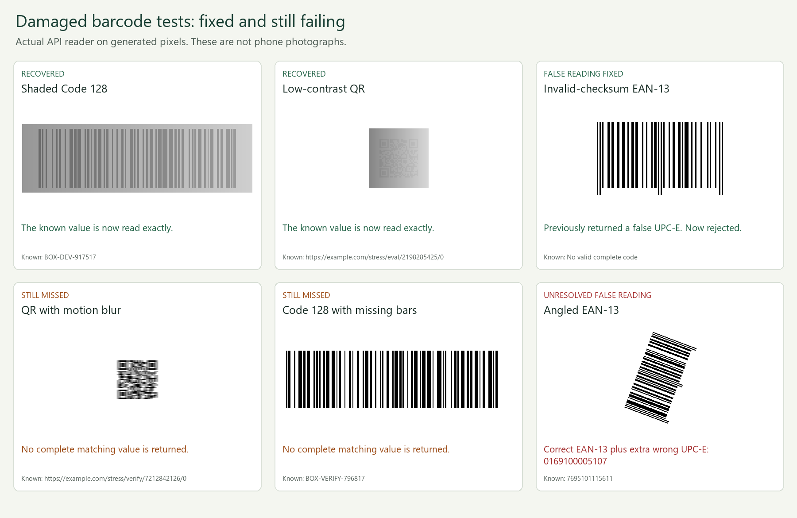

# Damaged barcode and QR test results

These are historical 0.5.0 results. See [the 13 November recognition update](ACCURACY-UPDATE.md) for the current changes and fresh evaluation. All three sets described here, including the earlier verification set, are now development/debugging evidence.

Version 0.5.0 was tested on 12 November 2026 using the actual browser WebAssembly worker, API reader and custom Code 128 engine. The tests found missed reads, false readings and a camera-recording cleanup defect. Several were fixed; one first-pass decoding ambiguity remains documented below.

## What was tested

There are **657 generated images**: three sets, each containing 171 positives and 48 negatives. Each positive set contains 57 QR, 57 Code 128 and 57 EAN-13 images. Blur, motion blur, uneven lighting, low contrast, perspective, rotation, scratches, missing areas, small labels and clipping have two severity levels. Negatives include textures, barcode-like fragments, finder-like shapes and intentionally invalid checksums.

Payloads come from independent encoder inputs, never a scanner prediction. Each set has nine distinct positive payload groups; all transformations of one payload remain in that set. Thus 657 images are not 657 independent real-world examples. There are no phone photographs or Scanbot measurements.

- `damage-stress-dev.json`: seed 93640117, frozen before initial changes and used for development.
- `damage-stress-eval.json`: seed 57422093, initially held out. It exposed a checksum-valid false UPC-E reading, so it was **promoted to debugging data** and is no longer presented as untouched evaluation.
- `damage-stress-verify.json`: fresh seed 86214377 and disjoint payloads, frozen before the final verification runs. Each reader was frozen before its verification run. No algorithm changes followed its final verification results.

The generator, verification wrapper, fixture parameters, dependency versions, source hashes and per-case reports are included. `.gitattributes` preserves LF line endings for frozen fixtures and sources on Windows.

## Exact reads and false readings

An image succeeds only when every expected value and format is present **and no unexpected result is returned**. A correct value plus a wrong extra value is a failure. “Wrong results” below counts returned unexpected records, so two wrong detections in one image count twice. The custom engine's benchmark selects only Code 128 positives and the 48 negative images; it excludes QR/EAN positives rather than treating unsupported formats as missed Code 128 reads.

| Set | Reader | Exact positive reads, before → after | Negatives correctly rejected, before → after | Wrong results, before → after |
| --- | --- | ---: | ---: | ---: |
| Development | Browser | 112 → 128 / 171 | 48 → 48 / 48 | 2 → 0 |
| Development | API | 114 → 126 / 171 | 48 → 48 / 48 | 2 → 0 |
| Development | Custom Code 128 | 38 → 44 / 57 | 48 → 48 / 48 | 0 → 0 |
| Promoted debugging set | Browser | 117 → 131 / 171 | 46 → 48 / 48 | 4 → 0 |
| Promoted debugging set | API | 119 → 130 / 171 | 46 → 48 / 48 | 4 → 0 |
| Promoted debugging set | Custom Code 128 | 40 → 45 / 57 | 48 → 48 / 48 | 0 → 0 |
| Fresh verification | Browser | **107 → 124 / 171** | **48 → 48 / 48** | **1 → 1** |
| Fresh verification | API | **109 → 121 / 171** | **48 → 48 / 48** | **1 → 1** |
| Fresh verification | Custom Code 128 | **39 → 46 / 57** | **48 → 48 / 48** | **0 → 0** |

No decoder errors occurred. Every exact positive read from the starting version was retained in the final development and verification runs. The stricter API geometry check declined two newly recovered intermediate cases, one in development and one in the promoted debugging set; those were already misses in the starting version and are counted as misses in the final table.

Reports are in [benchmark-results/damage/](benchmark-results/damage/), including [browser verification](benchmark-results/damage/browser-verify-after.json), [API verification](benchmark-results/damage/api-verify-after.json) and [custom verification](benchmark-results/damage/custom-verify-after.json).

The fresh verification breakdown makes the QR results explicit. Each format has 57 cases, deliberately including difficult and incomplete symbols:

| Format | Browser exact reads, before → after | API exact reads, before → after |
| --- | ---: | ---: |
| QR | 33 → 34 / 57 | 35 → 37 / 57 |
| Code 128 | 38 → 48 / 57 | 38 → 44 / 57 |
| EAN-13 | 36 → 42 / 57 | 36 → 40 / 57 |

## Fixed defects and remaining failures

Local illumination correction recovers some shaded/low-contrast labels. Bounded resampling helps the decoder sample some small modules. The browser also estimates bar direction for its illumination retry. The custom engine adds local thresholding, original source-row retries and horizontal resampling without counting interpolated vertical rows as independent evidence.

Two false-reading families were fixed:

1. Clipped or invalid EAN-13 images became unrelated short ITF/Codabar values during transformed recovery. Recovery now restricts both requested and accepted formats to those with mandatory checksums or error correction. Original-image format support remains unchanged.
2. One invalid EAN-13 checksum image became a checksum-valid UPC-E after rotation. Recovered linear results now require coherent source bars whose gradient direction agrees with the returned scanline. The check samples at most 4096 source positions per result. The browser pads thin detection boxes and jitters the sample grid to avoid edge-only measurements and periodic sampling aliasing.

These checks reduce specific failures; checksums and geometric agreement do not prove correctness. The fresh verification still has **one unresolved ambiguity**:

- Case: `ean13/verify-ean13-label-2/angled-2`.
- Known EAN-13: `7695101115611`.
- Both standard readers also return the wrong UPC-E value `0169100005107`.
- This happens on the untouched first decoder pass, before recovery. The correct EAN-13 is returned too, but the image is counted as unsuccessful.
- The browser/API verification commands therefore **exit with status 1**. This result is retained, not suppressed or converted into a passing test. A persistent false value may also survive repeated-frame confirmation.

Severe blur, clipping, large missing regions, scratches through QR structure and some tiny labels still fail. A miss is preferable to inventing a value, but these results do not establish that every miss is fundamentally unrecoverable.



[Original example PNGs](benchmark-results/damage-examples/) preserve their test pixels; the contact sheet resizes them only for display.

## Speed and limits

Clean original-pass successes still return immediately. Additional recovery costs time on difficult images. In the recorded fresh-verification run, median / p95 host decode times were:

| Reader | Before, milliseconds | After, milliseconds |
| --- | ---: | ---: |
| Browser worker | 16.43 / 238.49 | 45.89 / 428.36 |
| API reader | 3.789 / 36.341 | 4.830 / 55.314 |
| Custom engine | 3.525 / 9.568 | 7.458 / 14.947 |

These are single-run Windows host observations, affected by runtime, warm-up and machine load. Do not compare them as phone performance or as a precise speed ranking between native, WebAssembly and JavaScript runtimes. The API benchmark excludes HTTP and upload parsing. All three exclude camera acquisition and live confirmation. Live scanning runs at most one fallback per frame; imported-image/API scans may start up to six fallbacks. Pixel limits and retry deadlines remain, but one synchronous decoder call cannot be interrupted by the elapsed-time check.

## Android and iPhone simulations

All **35 mobile capability/lifecycle simulations passed**. They execute the actual app/lab scripts with Android Chrome-like and iPhone Safari-like feature profiles. They cover permission timing, optional camera controls, presented/decoded frame counters, WebM/MP4 negotiation, missing APIs, interrupted capture and cleanup. A failed MediaRecorder constructor previously leaked its canvas stream; that is fixed and covered by a regression test.

These are Node simulations, **not actual Android/iPhone browsers, emulators, codecs or hardware**. Worker outputs in these lifecycle tests are controlled; decoder accuracy is measured separately by the pixel benchmarks above. See [MOBILE-TESTING.md](MOBILE-TESTING.md).

The complete suites pass **88 Python tests and 174 Node tests**, with one Windows symlink test skipped. That is distinct from the known failing stress-verification case.

## Reproduce

From the project folder with its Python dependencies and Node 22+ installed:

```powershell
node --test tests/*.test.mjs
.\.venv\Scripts\python.exe -m pytest -q

New-Item -ItemType Directory -Force data/local
node tools/benchmark-accuracy.mjs --corpus tests/fixtures/damage-stress-verify.json --output data/local/verify-browser.json
.\.venv\Scripts\python.exe tools/benchmark-damage-api.py --corpus tests/fixtures/damage-stress-verify.json --output data/local/verify-api.json
node tools/benchmark-damage-custom.mjs --corpus tests/fixtures/damage-stress-verify.json --output data/local/verify-custom.json
```

The browser/API verification commands currently return status 1 for the ambiguity above. Replace `verify` with `dev` or `eval` to run those sets.

To reproduce the starting versions, add `--worker tools/baselines/v0.4.0/scanner-worker.js` to the browser command, `--reader tools/baselines/v0.4.0/barcode_reader.py` to the API command, or `--engine-dir tools/baselines/v0.4.0/custom` to the custom command. Earlier source snapshots intentionally retain their known defects.

Regenerate the frozen fixtures and optionally export development PNGs:

```powershell
.\.venv\Scripts\python.exe tools/generate-damage-stress.py --images data/local/dev-images
.\.venv\Scripts\python.exe tools/generate-damage-verification.py
```

GitHub Actions runs unit/regression tests and all three **development** damage benchmarks on pushes and pull requests. The separate verification report remains explicit evidence of the unresolved failure. Wrong results and engine errors fail benchmark commands; misses remain visible in their per-case reports. Future tuning on the verification set must stop calling it untouched validation and reserve new independent data.
